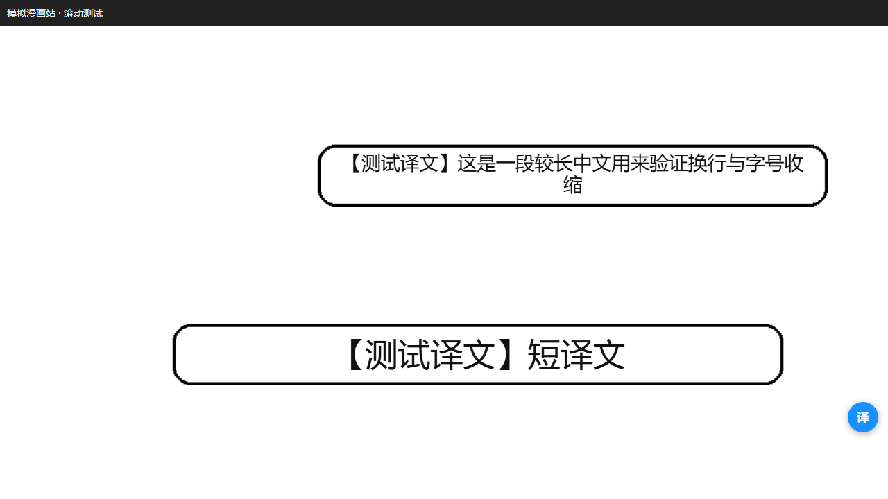

# 页内即时翻译 / Screen Instant Translate

识别屏幕或网页里的外文，把译文**原位盖在原文上**——不改页面结构、不跳转、不打断阅读。
手机看日漫/韩漫/英文条漫，点一下按钮，1 秒左右出中文。

| 端 | 形态 | 说明 |
|---|---|---|
| 浏览器 | 书签 / 油猴脚本 | 在任意漫画网页里原位覆盖译文，页面零改动 |
| 安卓 | APK | 悬浮球 → 截屏 → 全屏译文层覆盖在任意 App 上 |
| 服务 | 本地 Python | OCR 在本机跑（快），只把文字发给翻译接口 |



## 实测

单页 900×1300：OCR 0.4s，翻译 0.3~0.6s，合计约 1s；命中缓存 ~0ms。

- OCR 不上云：RapidOCR(onnxruntime) + 日/中/韩三套 PP-OCRv4 识别模型，**逐行挑置信度最高的那个**，天然支持单页混排
- 竖排日文自动转 90° 识别，译文按竖排渲染
- 翻译只发文字，比"把整张图交给视觉大模型"快一个数量级、也便宜一个数量级

## 一、起服务

```bash
pip install -r server/requirements.txt
python server/models/download.py     # 下日文/韩文识别模型（约 35MB）
cp server/config.example.json server/config.json
python server/run.py                 # 或双击 server/start.bat
```

打印两个地址：

```
本机: http://127.0.0.1:8017
手机: http://192.168.x.x:8017   (同一 Wi-Fi)
```

打开页面，把 [硅基流动](https://siliconflow.cn) 的 API Key 粘进「翻译接口」，模型 `Qwen/Qwen3.5-9B`，保存。
不填也能识别，但不会翻译。

## 二、手机浏览器（书签）

安卓用 Kiwi Browser 或 Firefox 打开上面的地址，把「译 · 页内翻译」拖到书签栏。

- 点「译」：翻当前屏
- 长按「译」：自动模式，滚到哪翻到哪，提前 400px 预取
- 同一张图第二次 0 延迟

原理：只往页面塞一个 `position:fixed` 图层和一颗悬浮球，**不包裹 img、不改 DOM 顺序**，所以不会把站点布局搞乱。

## 三、安卓 App

下载 [Releases](../../releases) 里的 `screen-translate-v1.0.apk`，或者自己编译：

```bat
cd android
build.bat D:\path\to\android-sdk
```

装好后：填电脑地址 → 开始 → 授权悬浮窗和录屏 → 屏幕上出现蓝色「译」球，点一下翻译当前画面。

## 目录

```
server/
  server.py          /api/translate /api/config /api/health
  ocr.py             RapidOCR：det 一次，日/中/韩 rec 并行，逐行取最优
  mt.py              翻译：OpenAI 兼容接口（硅基流动等），按图哈希缓存
  web/bm.js          页内脚本：叠加译文、跟随滚动、localStorage 缓存
  web/index.html     设置页 + 截图试译
android/
  OverlayService     悬浮球 + 全屏译文层
  Capture            MediaProjection 抓帧
  TranslateView      自绘白底气泡，自动换行缩字
```

## 注意

- 服务只监听局域网，默认没有鉴权，别暴露到公网
- 翻译接口按量计费；OCR 全在本地，不花钱
- Android 14 每次重开 App 都要重新授权录屏

MIT License

---

## 独立版（v2，推荐）

上面是"电脑跑服务 + 手机当客户端"。**v2 把 OCR 搬进了手机**，电脑不用开：

- 模型按需下载：文字检测 4.5MB（共用）+ 日 9.3 / 中 10.4 / 英 7.3 / 繁中 10.6 MB
- APK 约 17MB（含 onnxruntime arm64），识别离线、翻译联网
- 源码在 `app/`，发布在 [Releases](../../releases) 的 `screen-translate-v2.0.apk`
